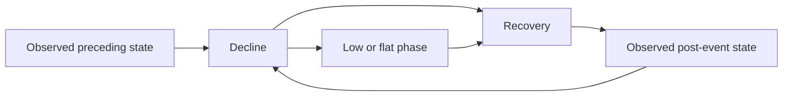

# Replacement timing model: flat troughs and asymmetric recovery

9 November 2026. Approved milestone **POCKET-VIDEO-DETECTOR-06**. Owner: Codex (root), without delegation. The researcher requests a plan for FB2413 and FB2412, preserving spatial evidence, burden formula, normalization and original results. The researcher approved this bounded implementation; the preceding boundary experiment remains delivered and stopped.

## Intended outcome

Recognize the complete temporal episode without forcing a triangular shape or asking the researcher to assign exact frames repeatedly. Allow a decline to enter a low plateau and recover at a different speed. Report a timing range, conditional return or censored episode when the data cannot identify a unique boundary. Keep recognition of a candidate separate from eligibility of its scientific measurement reference.

The [previous review and results](BOI_VIDEO_BOUNDARY_REVISION_RESULTS.md) identify four design failures: an overly restrictive three-line fit, recovery targets tied to three samples near the fitted turn, apparently precise boundaries at a search limit, and a confirmed-looking return label derived from a rejected onset. The replacement must address those failures explicitly rather than adjust thresholds until familiar endpoints match.

## Proposed model

Use graph-constrained phase segmentation, with dynamic programming over the observed trace. The phases describe the latent signal trend; raw fluctuations remain visible and unchanged.

The low phase is optional. Its entry and exit are separate from the episode's onset and recovery completion. Legal paths also include no added episode, an episode already present at the beginning, and an incomplete episode at the end. A renewed decline before adequate separation remains linked or uncertain. Missing or motion-flagged spans split observational support; the model must not invent continuity through them.

The computational precedent is constrained changepoint inference with a state graph and transition penalties. [Runge et al., 2023](https://www.jstatsoft.org/article/view/v106i06) describe a general graph framework; [Hocking et al., 2020](https://jmlr.org/papers/v21/18-843.html) describe constrained dynamic programming and the importance of selecting penalties. Adapting that family to these oxygen-signal episodes is our proposed design inference, not a published validation of a hypoxic-pocket detector. This plan does not introduce an R dependency or claim to reproduce those implementations or their performance guarantees.

### Flexible phase shapes

- Fit declining and returning trends with low-complexity, shape-constrained levels that can change slope. Give decline, low phase and recovery independent durations; impose no symmetry or shared fall/rise rate.
- Compare the episode path with a no-added-episode explanation that can contain an observed stable level, drift or continuing recovery. A path containing a dip must earn its extra complexity.
- Use a penalized data-fit objective. Record the noise treatment, transition costs, within-phase flexibility and duration regularization before recording evaluation. These are experimental engineering choices selected on the constructed fixtures below.
- Evaluate evidence for adjoining decline and permitted transitions across candidate paths before selecting the best admissible path. Do not select one invalid optimum, reject it and leave all other candidates unexamined.
- Preserve comparable paths and phase-boundary alternatives. Equal-cost assignments on a flat part of the trace remain ambiguous. A boundary at an observation/search limit is constrained, not precisely identified.

This is a small bounded prototype of the state model using the existing Python environment. The final production language remains undecided. Avoid a new general-purpose modelling framework or package installation.

### References and return evidence

First infer the observed phases and their uncertainty. Then evaluate whether an event-specific preceding reference is supported by the observations before all surviving decline-onset alternatives. Use a common supported reference window or reference set when comparing boundary alternatives. Do not silently change the recovery target as an onset shifts, and do not use a three-sample turning peak as an accepted baseline.

Stable preceding context, a still-recovering preceding state and unavailable preceding context must remain distinct. No borrowed reference from a different event or extrapolated fitted trajectory becomes a scientific baseline. This experiment proposes no automatic adoption of 10-second versus 20-second scientific reference windows.

Report at least three separate findings:

1. **Observed recovery phase:** the signal rises from its low phase and a post-event state is observed.
2. **Return relative to a supported preceding state:** the observed post-state is compatible with the supported reference, with uncertainty and residual deficit exposed.
3. **Scientific recovered-baseline eligibility:** unresolved unless the existing scientific reference contract supports it. A rising post-state or unresolved pre-state cannot establish a stable recovered baseline by itself.

Raw and qualified additional-local return can differ while a region continues responding. Assess their saved signals separately with the same model family, retaining both interpretations. FB2413's unsupported regional decomposition remains unsupported. The existing regional components, comparison-patch membership and role assignments are never refitted or reselected here.

The previous 90% closure and ten-sample rules remain historical diagnostics for comparison. They are not biological truth or mandatory definitions for the new phase model. Observed persistence and post-state variation enter the whole-path assessment. Any explicit observation-duration or deficit criteria used by the prototype must be declared and frozen, and cannot convert missing information into confirmed recovery.

### Output contract

Each proposed timing carries its supporting phase path, source cohort, reference status, conditional dependencies and censoring reason. Include explicit fields for onset status, recovery-phase status, reference-return status, stable-baseline eligibility, unresolved causes, and whether an estimate is limited by an observation/search boundary.

If an onset or reference is unresolved, every dependent return estimate must have an explicit **conditional** status in the data itself. A graph or report caption is insufficient. Missing-data and motion causes must survive clipping and propagate into the final output. No unconditional confirmed endpoint or measurement-ready flag is supplied from a rejected turn.

## Finite source set

Reuse exactly the saved windows **FB2413 608–1114** and **FB2412 5–839**, with the existing external 1 Hz authority. Work on the complete available context within each window. Old temporal fit limits are comparison annotations, not hard onset boundaries. Quality flags still delimit observed support.

| Recording | Fixed diagnostic cohorts | Additional saved comparison traces |
| --- | --- | --- |
| FB2413 | ID 21173, 73 blocks; ID 15040, 55 blocks | Patch 50, quiet-supported role; patch 68, responding-regional role |
| FB2412 | ID 2763, 125 blocks; ID 2348, 2,024 blocks | Patch 144, quiet-supported role; patch 82, responding-regional role |

The comparison traces are the first quiet-supported and first responding-regional patches in each target's previously frozen patch order. Their episode-specific role labels are used after inference as context checks, not as ground-truth training labels for the entire window. No additional patch selection is allowed.

This replaces the timing layer only. A dip-shaped path on a comparison patch describes a temporal signal; it does not establish a localized hypoxic pocket. Spatial extent, localization and regional-response qualifications retain their existing evidence and status. A high timing score cannot promote a broad regional response into an accepted pocket.

Use the four diagnostic raw traces and four comparison raw traces. The existing qualified local residual for the FB2412 core adds one channel, giving **nine fits to saved signals**. The four displayed diagnostic cohorts retain their identities. Associate inferred episodes with the existing proposal time neighbourhood; if association is ambiguous, preserve the ambiguity. Do not select another footprint or path because its endpoints resemble reviewed frames.

Display the saved original-ROI raw and corrected traces for FB2413 site 3/event 6 and FB2412 site 20/event 1 after inference. They remain context overlays and are not fitted or used to tune model settings. The sources and footprint identities are already verified in `reference-validation/boi-video-boundary-revision-20261109/recordings/*/comparison.json`.

This milestone evaluates these eight trace cohorts. The 72,732 archived hypotheses remain preserved; catalogue-wide refitting and the 17-recording batch are outside this first replacement-model scope. These known cases cannot establish independent detection performance.

## Development and verification

Record expected behaviour for **16 constructed fixtures** before their first evaluation:

1. Short V-shaped dip after stable context.
2. Fast decline with slow recovery.
3. Slow decline with fast recovery.
4. Long flat trough between decline and recovery.
5. Rounded low phase with no sharply identifiable trough frame.
6. Shoulder or double low without intervening recovery: retain a linked episode.
7. Two episodes with observed intervening return.
8. Renewed decline during preceding recovery: retain reference uncertainty.
9. Drift or recovery without a new dip: no added episode.
10. An isolated outlier or brief high excursion: no invented full episode or recovery.
11. An episode with correlated, varying-amplitude noise.
12. The corresponding correlated-noise control without an episode.
13. Additional local return while the regional raw signal remains depressed.
14. Recording begins in a low phase: left censoring and missing onset/reference.
15. Recording ends during recovery: right censoring.
16. Internal missing/motion span: no bridged recovery and correct retained cause metadata.

Constructed temporal shapes must include the rise–fall–flat-floor–return pattern that defeated the previous fit. Acceptance concerns representation, admissible transitions, uncertainty and absence of false confirmation. It does not require exact agreement with particular human-picked FB2413/FB2412 frames.

For the tiny fixture versions, independently enumerate admissible paths or replay segment costs to check the dynamic-programming solution. Reuse those same named fixtures; do not introduce an unbounded additional test suite. Check the dependency contract, limit-boundary qualification and cause propagation explicitly.

After the constructed checks, freeze **one configuration** before examining fitted results on either recording. Then run the nine fits to saved signals and a predeclared stability check: **12 residual-block perturbations for each of the four diagnostic raw traces and the one qualified local trace**, giving 60 additional fits and **69 recording-based fits in total**. Use fixed random seeds, a recorded block-selection rule, and aligned perturbations for a cohort's raw/local pair. These are numerical stability stress checks, not new observations or calibrated confidence intervals. Do not tune from their outcomes.

Independently verify selected phase costs, admissible paths, source identities, dependency/censoring flags and all displayed ranges. Report boundary/path stability and failures, not just a best frame and pass count. No sensitivity, specificity or biological readiness claim follows from this fixture set.

## Work items

| Item | User benefit and scope | Acceptance evidence |
| --- | --- | --- |
| VPHASE-01 | Fit whole episodes with an optional low phase and independent decline/recovery shapes. | Constructed flat-bottom and asymmetric cases are represented without a forced triangular fit; no-episode and linked alternatives remain possible. |
| VPHASE-02 | Make reference, boundary and censoring uncertainty part of the data contract. | Rejected or unresolved contexts never yield unconditional endpoints; search-limit ambiguity and gap/motion causes are preserved. No scientific baseline is invented. |
| VPHASE-03 | Freeze and compare the finite source set and declared stability perturbations. | Nine fits to saved signals plus 60 stability fits, using the same spatial and regional evidence. Every success, unresolved case and mismatch is reported under the frozen configuration. |
| VPHASE-04 | Deliver two whole-episode cards, an independent verification receipt and a short keep/replace assessment. | Display both original-ROI contexts, the existing videos, old/new phase interpretations and every conditional boundary. Preserve source/result hashes. The researcher receives two compact cards rather than a frame-by-frame labelling task. |

## Protected scientific contract

Preserve spatial masks, support qualification, comparator roles, regional components and source-specific tissue support. Make no new segmentation, correction or source-image analysis. Original movies, previous prototypes, automatic and reviewed results, scientific references, production MATLAB workflow and export formats are protected read-only inputs.

- FB2413 823–825 remains a timing cue and its measurement baseline remains unresolved. Earlier onset judgment 826–827 and approximate endpoint near 851 are post-inference annotations, not fitting targets.
- FB2412 accepted onset 114, recovery 182 and baseline 104–113 remain unchanged. Patch 82 retains its responding-regional annotation.
- Keep the burden formula, normalization and strict complete-burden missingness rule unchanged. Compute no new scientific amplitude, event area, contribution, partial sum, recording burden or export from this preview.

## Proposed limits and stopping condition

Approved limits: **eight active engineering hours, four batches, 16 constructed fixtures, nine fits to saved signals, 60 fixed stability fits, one frozen configuration, two engineering repairs, 2 GiB measured worker memory and 256 MiB new evidence**. Owner is root with no delegation. Reuse the existing Python environment, cached signals, source checks and media. No new dependency installation, movie decoding, native MATLAB launch, Git transport or publication is included.

The batches are (1) source/output contract and fixture specification, (2) phase-model implementation and constructed checks, (3) frozen fits to saved signals and stability checks, and (4) independent verification, presentation and closeout. Scientific model/parameter repairs occur before freezing. A post-freeze numerical/source defect produces a preserved checkpoint; an output-preserving engineering repair needs exact numerical parity and still counts toward the two-repair limit.

Process source cohorts in isolated workers under the measured memory cap. Use a bounded implementation on these short traces and store selected paths/cost profiles, not dense archives of every possible path. A source-integrity, effort, memory, storage or repair boundary stops the work with a preserved partial checkpoint.

Stop after the two cards, verification receipt and explicit assessment of whether the replacement actually resolves the observed model failures. Honest unresolved results satisfy the experimental reporting contract; they do not constitute detector acceptance. Production adoption, wider validation, catalogue/batch integration and scientific measurement changes require separate scope decisions. Deferring implementation leaves the current workflow and saved cards intact.

The researcher approved these bounded work items under [existing-analysis/AGENTS.md](../AGENTS.md). Approval received: “i approve.” The milestone is delivered and stopped; see the delivery record below.

## Delivery record

Delivered and stopped on 9 November 2026: four batches, sixteen constructed fixtures, nine saved-signal fits, sixty fixed stability fits, one configuration and two repairs (one model noise repair before freeze; one independent-checker arithmetic correction). [Results](BOI_VIDEO_PHASE_TIMING_RESULTS.md) and [cards](../../reference-validation/boi-video-phase-timing-20261109/review.html) record the FB2413 miss, conditional FB2412 phases and the recommendation against adopting the current scoring. Scientific results remain unchanged.
